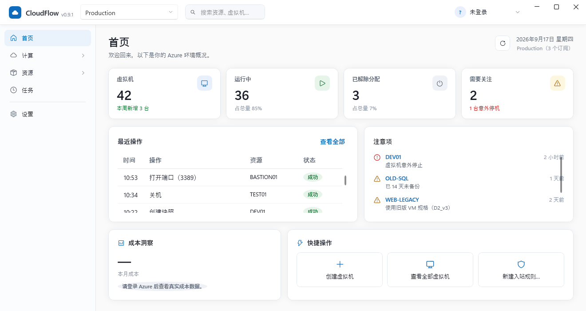

# 用户手册

CloudFlow 是一个面向 Microsoft Azure 的桌面运维工具，用于管理虚拟机与清理不再使用的资源。
本篇介绍界面各部分的用法。安装与账户配置见 [`authentication.md`](authentication.md)；
架构原理见 [`architecture.md`](architecture.md)。

## 首次启动

未登录任何账户时，CloudFlow 处于 **Demo 模式**：界面显示的是演示数据，可以放心点开每一个页面、
试用创建/删除虚拟机等全部流程，不会触碰任何真实 Azure 资源。顶栏账户区域会显示"未登录，当前为
Demo 模式"。

要接入你自己的 Azure 账户，见 [`authentication.md`](authentication.md)：工作/学校账户与个人
Microsoft 账户都支持，可以同时登录多个，随时在顶栏切换。

## 界面布局

- **顶栏**：从左到右依次是应用标识、**Scope 选择器**、全局搜索框、任务进行中徽标、终端会话入口、
  账户菜单。账户菜单显示的是**登录名**（如 `name@contoso.com`）而不是展示名——展示名可能重复
  （比如同一个人的工作账户和个人账户展示名一样），登录名才能唯一确认当前生效的是哪一个账户；
  展示名仍会出现在悬浮提示和账户切换菜单的副标题里。
- **左侧导航**：首页、计算（虚拟机）、资源（所有资源 / 资源组）、成本分析、任务、设置。
- **主区域**：当前页面内容。

### Scope 选择器

Scope 决定当前看到的数据范围，可以是某一个具体订阅，也可以是"所有订阅"（当前账户全部可访问的
订阅汇总）。刻意不叫"Subscription"，因为一个 Scope 可以横跨多个订阅。

### 系统托盘

CloudFlow 启动后常驻系统托盘（通知区域）：

- **双击图标**：还原并激活主窗口。
- **右键菜单**：「打开 CloudFlow」「查看任务」（打开主窗口并跳到任务中心）「设置」
  （跳到设置页）「退出 CloudFlow」（真正退出——无论下面这条设置开没开）。
- **关闭窗口时最小化到通知区域**（设置 → 通用，默认关闭）：开启后点主窗口右上角的「×」
  只会隐藏窗口并弹一次气泡提示，程序仍在托盘运行；关闭该设置则点「×」直接退出。

## 首页

点击统计卡可进入当前 Scope 的虚拟机列表：总数查看全部，运行中、已解除分配、需要关注分别按对应状态筛选。
跳转会清除旧的名称、资源组和区域筛选并回到第一页；也可用 Tab 聚焦、Enter 或 Space 打开。

概览当前 Scope 下的关键信息：虚拟机总数与运行状态分布、最近的操作记录、需要关注的异常（如处于
非预期电源状态的虚拟机）、成本洞察（已登录真实账户时显示实际 Azure 账单数据）、常用操作快捷入口。

## 虚拟机

### 查看与筛选

列表支持按名称搜索、按状态 / 资源组 / 区域筛选。单击选中行，双击数据行或选中后按 Enter 进入详情，查看摘要、网络、磁盘、性能、活动记录。右键先选中被点击的行，再显示该行操作；复选框用于批量操作。筛选器有固定字段标签，组合条件同时生效，清除筛选可恢复全部结果。

### 创建虚拟机

点击「创建虚拟机」，两步向导：

1. **基本信息**：名称、区域、镜像（Ubuntu / Windows Server 等常用镜像）、规格（按 vCPU/内存与是否
   支持你选的镜像世代自动排序推荐）、资源组（可以选一个已有的，也可以填一个新名字——不存在则
   自动新建、存在则直接复用，不会改动其现有配置）。
2. **网络与凭据**：虚拟网络、子网（同样是"不存在则新建、存在则复用"）、是否需要一个公网静态 IP、
   登录方式（Linux 支持 SSH 公钥或密码，Windows 仅密码）。

点击「创建」后对话框会保持打开、就地显示创建进度（资源组 → 网络 → 网卡 → 虚拟机），失败时原地
显示失败原因，不需要重填一遍表单。密码在提交前先写入本机加密的凭据库，不会以明文形式在网络请求
之外的任何地方出现。

### 电源操作与更多操作

行尾「⋯」菜单提供启动、重启、关机、解除分配、更改规格、删除等操作。删除虚拟机时可以选择一并
删除网卡、系统盘、数据盘、公网 IP（默认全选，可取消）——虚拟网络与子网不会被连带删除（它们可能
被同一资源组下其它虚拟机共用）。

写操作先经过 Operation Engine 校验、影响分析和权限判定。风险类审批默认关闭，可设为「仅高危」或「所有写操作」；是否暂停由策略与实际影响决定。删除及共享子网 NSG 影响确认不可绕过。解除分配可能按当前策略直接执行，操作前请核对目标。

### 端口规则（NSG）

详情页「网络」标签聚合了这台虚拟机的网卡、虚拟网络、子网与网络安全组（NSG），并列出自定义的
入站 / 出站端口规则（Azure 的默认规则不在列表中，它们始终生效）。可以直接：

- **新建规则**：「新建入站规则…」「新建出站规则…」打开创建对话框——**操作**可选允许（Allow）
  或拒绝（Deny）；规则名称默认按「操作 + 端口 + 方向」自动生成（如 `Allow8080InBound`，与
  Azure 内置规则的命名方式一致），手动改过后不再自动覆盖；端口默认 8080，来源/目标默认
  「任意 (Any)」，均可修改（支持选择「我的当前 IP」「该虚拟机所在子网」，或手填 IP/CIDR）。
- **更改端口**：只改端口号，协议 / 来源 / 其他设置保持不变。
- **更改优先级**：通过行菜单「更改优先级…」编辑 100–4096 内的整数，只改优先级，
  其他字段保持不变；确认匹配顺序影响后执行，同一 NSG 的同方向优先级冲突会被拒绝。
- **删除规则**：先经过影响分析确认。

规则表同时显示序号、名称、优先级、源、目标、端口、协议、动作和来源；仅选中行加粗。
新建规则的建议优先级默认从 400 起按 10 递增（400、410、420…），整十档全部占用时再选择其他空闲整数。

来源 / 目标为「任意 (Any)」的新规则（无论允许还是拒绝）会评估风险并按当前审批策略决定是否暂停：允许 + 任意是新增
暴露面，拒绝 + 任意则可能连带挡住优先级更低的放行规则——确认框会按实际语义分别说明。子网级
NSG 的规则变更会影响同一子网内的所有虚拟机，此类确认不可在设置中关闭。

## 性能指标

登录后性能页读取 Azure Monitor 平台指标，不会用演示值填补查询失败。显示最近有效聚合点，
查询最近 30 分钟、请求粒度 5 分钟；面板标注采样日期范围，指标可能不同步并存在分钟级延迟。
“—”表示指标未返回数据，真实零值保留为 0，微小非零值不会四舍五入成零。
磁盘 IOPS 与带宽百分比表示相对规格限额的消耗，不是磁盘空间占用；部分指标仅在支持的规格上可用。

## 资源清理

「创建虚拟机」按需新建的资源组/虚拟网络不会在删除虚拟机时被自动清理（见上文），CloudFlow 提供
专门的清理入口：

### 所有资源

列出当前 Scope 下的每一件资源（不止虚拟机）。筛选分两部分：一个按名称的搜索框（子串匹配），
外加**类型 / 资源组 / 区域**三个下拉筛选器——每个下拉旁边都有固定的说明文字，不会因为选中了
具体值就看不出这个下拉是筛哪一列的；下拉默认值也带字段名（如「全部类型」），跟名称关键字按
"同时满足"的方式组合筛选。可以勾选多项、点击「删除所选」一次性清理；虚拟机行不提供删除
（虚拟机有自己专门的删除流程，见上文），只提供「查看虚拟机」跳转。

### 资源组

按资源组查看，显示每个资源组内的资源数量。筛选同样是名称搜索框 + **区域 / 订阅**两个下拉
筛选器。删除资源组是**级联删除**——组内所有资源都会被一并删除，破坏面比删除单个资源大得多，
因此确认框要求**输入资源组名称本身**才能继续（对齐 Azure 门户自己删除资源组的交互）。同样
支持勾选多个资源组批量删除。

批量删除时，所有目标会先分析影响、合并成一个确认框统一展示，确认后逐项执行并显示进度；中途
取消会作废这一批还没执行的操作，不会遗留一堆"半途而废"的待处理项。删除确认框里的「目标资源」
用醒目的危险色高亮显示，避免在批量操作中看错要删的对象。删除失败时会展示 Azure 返回的具体
原因（比如资源仍被其它资源引用），而不是一段原始的 HTTP 错误信息。

## 任务

记录所有写操作的执行历史：谁在什么时候对哪个资源做了什么、结果如何。任务进行中时，顶栏的
"任务进行中"徽标会持续显示当前进度，不需要停留在触发它的那个页面或对话框上才能看到。

## SSH 终端

虚拟机详情页与列表页都提供直接建立 SSH 连接的入口，登录后在应用底部的终端面板打开一个新标签，
支持同时开多个会话、每个会话独立的标签页。连接凭据（密码或私钥口令）保存在本机加密的凭据库中，
首次连接一台新主机会要求确认主机指纹，指纹变化时会强提示（不会静默接受，防止中间人攻击）。

连接失败时，标签会明确显示「连接失败」，悬停可见具体原因（认证失败、连接超时、主机密钥被拒
等），不会停在模糊的「待连接」状态；排除问题后重新点「连接」即可用全新会话重试。

## 设置

- **通用**：浅色 / 深色 / 跟随系统主题；紧凑表格（行高立即切换）；开机时启动 CloudFlow；关闭窗口时最小化到系统托盘通知区域。
- **账户**：管理已登录的账户、配置登录服务（应用（客户端）ID）。
- **凭据管理**：SSH 连接凭据的增删改查。
- **操作与审批**：写操作的审批策略（所有写操作 / 仅高危 / 关闭），默认关闭；已有明确设置保留。删除及共享子网 NSG 影响确认始终启用。
- **列表与刷新**：列表分页大小、自动刷新间隔。
- **网络**：Azure 请求超时、公网 IP 自动查询等偏好。请求超时默认 300 秒（5 分钟），
  可选择 60 / 120 / 180 / 300 / 600 / 900 秒；对后续请求生效，正在进行的请求保留原超时。
  该值限制单次网络请求，SDK 重试或长时间操作的总等待可能更久。
  SSH、交互登录、Runtime 下载和公网 IP 查询使用各自的超时设置。初始化超时后可检查网络或代理再刷新重试。
- **本地数据**：查看本机数据存储位置、清除本地任务历史。
- **关于**：版本与运行模式、开发者、源码仓库（可点击跳转）与许可证信息。

所有设置项修改后立即生效，没有"保存"按钮——这些都是可以随时改回去的本地偏好。

## 网络规则编辑与审批

- 点击规则名称打开主窗口右侧编辑面板，选择修改目标端口或优先级。每次修改一个字段。提交后按审批策略直接执行或暂停等待影响确认。
- 新建规则同样遵循审批策略，在右侧面板展示必要的影响确认。执行失败保留输入，可修改后重新检查；返回修改或关闭会取消本次待审批任务。
- 入站与出站共享名称搜索、Allow/Deny 和网卡/子网筛选；标题显示筛选后数量 / 总数。刷新保留筛选和当前选中规则。
- 网络刷新失败保留该虚拟机上次读取的数据，并显示失败状态；切换虚拟机时清空旧规则，避免混用资源数据。

## 刷新、取消读取与任务反馈

- 虚拟机列表刷新时保留可操作的列表，顶部显示读取状态和取消入口；刷新失败保留已有内容。
- 详情页摘要、网络、磁盘、性能分别显示读取结果与更新时间，支持分区刷新/重试。任一分区的「取消读取」会停止当前详情页全部读取，其他写操作仍按任务状态执行。
- 连续刷新自动取消上一次读取，迟到结果不会覆盖最新数据；离开详情页会取消读取。账户或 Scope 切换时返回列表，避免把旧上下文数据用于新账户。
- 任务中心与详情页审批窗口在执行期间显示任务进度，执行中不能关闭或重复提交。终态失败或无法确定结果的异常不会直接重新审批，请在任务中心核对结果后从资源页面重新操作。
- 任务中心「执行中」包含校验、影响分析、等待 Azure 和结果验证阶段；新增「已取消」筛选，顶栏分别显示执行中与待审批任务数量。

## 网络页布局

网络页顶部集中显示公网 IP、专用 IP 与网络安全组；网卡、虚拟网络、子网和 DNS 信息在「连接与地址详情」中展开，地址仍支持复制。入站／出站切换共用一套搜索、筛选与新建入口，新建默认使用当前方向。规则表占满内容宽度，连接资源图信息保留在「出站连接详情」中。

点击规则名称或新建规则，主窗口右侧展开编辑面板；正文可滚动，底部确认与取消按钮保持可见。变更检查、影响确认、执行及失败重试流程保持一致。

## 查看操作详情

首页“最近操作”和任务列表支持双击行、选中后按 Enter 或点击“详情”查看同一个只读面板。
顶栏“进行中的任务”也可点击查看。面板显示完整结果、错误、时间、资源与请求标识及该任务的已有审计记录，
运行中状态会同步更新；可刷新、复制详情或关闭。查看详情不会批准或再次执行任务。

## 成本分析

左侧导航“成本分析”与首页成本卡片的“查看成本分析”均进入独立页面，沿用顶栏当前 Scope。支持本月、上月、近 7 天、近 30 天和自定义日期；日期按 UTC 日历日计算，选择后单击“查询”。首页本月合计覆盖当前 Scope 中的订阅，不同币种分别显示。

“汇总方式”可在“按资源”和“按资源组”之间切换，使用同一批查询结果在本地汇总，不重复请求 Azure。同名资源组按订阅区分，不同币种单独计算，未关联资源组的费用也保留。

明细采用与资源列表一致的表格样式，显示序号、资源名称及类型、资源组、费用、币种和订阅。资源、资源组、订阅使用独立下拉筛选，也可通过关键词搜索；筛选合计按币种分别计算，不改变当前 Scope 合计。完整资源 ID 可悬停查看或选中后复制。同名资源按完整 ID 区分，选项包含类型。

日期采用短日期格式。查询状态与完整日志分开显示；展开日志后可滚动查看所有失败信息并复制全文。较小窗口支持整页滚动，表格和日志也各自保留滚动区域。未关联资源的费用保留为独立条目；抵扣费用和零金额也保留。费用采用 Azure Cost Management 的 ActualCost，数据可能延迟更新。

查询需要相应订阅的 Cost Management 读取权限。部分订阅失败时明确显示失败原因，只合计查询成功的订阅；全部失败显示“—”，不以零金额替代。切换账户或 Scope 时成本页面会清除旧范围结果并重新查询；离开页面会取消未完成读取，迟到的结果不会覆盖当前页面。返回页面保留此前的日期范围和汇总方式。

## 列表选择与操作

虚拟机列表单击只选中行，双击数据行或选中后按 Enter 进入详情。复选框和“⋯”按钮保留各自行为；双击表头、滚动条或空白区域不会打开已选中的虚拟机。右键点击先选中目标行，再打开该行菜单。

所有资源、资源组以及虚拟机详情的网络规则、磁盘表格同样在右键时选中目标行。磁盘“创建快照”可从整行右键或“⋯”菜单使用，均传入被点击的磁盘，并沿用 Operation Engine 流程。

## 升级与常见问题

- 从旧版升级：先退出旧程序，再运行新版 EXE；无需删除 `%LOCALAPPDATA%\CloudFlow`。已有审批设置保留；旧设置缺少请求超时或紧凑表格字段时分别使用 300 秒和标准行高。
- 添加规则提示 `SecurityRuleConflict`：同一 NSG、同一方向的优先级必须唯一。建议值按 10 递增不代表 Azure 只允许整十数；手动修改仍可用 100–4096 的整数。另一客户端并发修改可能导致建议值失效，请刷新后重新选择。
- 初始化或查询超时：检查网络 / 代理后刷新重试，也可提高「设置 → 网络 → Azure 请求超时」。延长超时不能解决缺少权限或网络断开。
- 性能显示 0 或「—」：0 是有效零值，「—」是未返回数据；规格支持与采样延迟可能导致不同指标可用性不同。
- 成本不是发票：页面显示 ActualCost 费用分析，不提供发票下载、支付或税费账单核对；范围、时间与数据延迟可能导致与结算发票不一致。
- 任务已失败或结果不确定：先打开详情核对错误与审计记录，再判断是否从资源页重新操作，避免重复提交。
